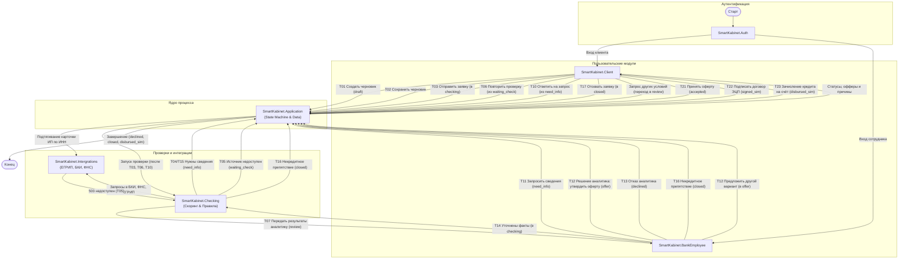

# BACKEND.md
Руководство и архитектурный контекст для AI-ассистентов, работающих в репозитории Alfa-Hack 2026 («Умный кредитный кабинет предпринимателя»).

---

## 1. Обзор проекта и концепция

Проект представляет собой кредитный кабинет для индивидуальных предпринимателей (ИП) и рабочее место аналитика банка:
* **Клиент (ИП)** оформляет заявку на кредит, загружает документы/выписки, отслеживает статус, получает прозрачные решения и встречные предложения.
* **Сотрудник банка (Аналитик)** проверяет результаты скоринга, досье заёмщика и выносит решение: утверждает и отправляет оферту клиенту (T12), выносит отказ (T13) или запрашивает сведения (T11).
* **Система (Автопроверка/Скоринг)** рассчитывает скоринговые баллы, чистый денежный поток, проверяет стоп-факторы и передает готовые результаты и рекомендации сотруднику (T07 -> review). Скоринг сам ничего не одобряет и оферту клиенту не отправляет.

* **Платформа**: .NET 10 (C#) / ASP.NET Core
* **Архитектурный стиль**: Модульный монолит (Modular Monolith) с Vertical Slice Architecture (VSA) внутри модулей
* **Шина сообщений и интеграции**: Wolverine (`WolverineFx`)
* **Точка входа**: ASP.NET Core Minimal API Host (`SmartKabinet.Host`)

---

## 2. Архитектура решения и структура модулей

```text
backend/
├── SmartKabinet.Host/             # Точка входа, DI-сборка, Wolverine configuration, Middleware, Swagger/OpenAPI
├── Modules/
│   ├── SmartKabinet.Auth/         # Аутентификация, авторизация, JWT/RSA, refresh-токены, роли (VSA)
│   ├── SmartKabinet.Client/       # API и бизнес-логика личного кабинета заёмщика (ИП) (VSA)
│   ├── SmartKabinet.BankEmployee/ # API и бизнес-логика рабочего места сотрудника банка (аналитика) (VSA)
│   ├── SmartKabinet.Application/  # Ядро заявок, управление анкетами и конечный автомат (State Machine T01–T17)
│   ├── SmartKabinet.Checking/     # Движок скоринга, расчёт метрик (DSCR, баллы) и проверка стоп-факторов
│   ├── SmartKabinet.Intergrations/# Адаптеры интеграций с внешними источниками / симуляторами (ЕГРИП, БКИ, ФНС)
│   └── SmartKabinet.Infrastructure/ # Общая инфраструктура: EF Core DbContext, PostgreSQL схемы, миграции
├── AlphaHack2026.sln
└── nuget.config                   # Централизованная конфигурация NuGet пакетов
```

### Ответственности модулей

* **`SmartKabinet.Host`**: Composition Root приложения. Содержит только сборку DI, конфигурацию шины Wolverine (`builder.Host.UseWolverine(...)`), настройку Authentication/Authorization Middleware, объединение Minimal API эндпоинтов модулей (`app.Map<Module>Endpoints()`). Бизнес-логики в Host нет.
* **`SmartKabinet.Auth`**: Изолированный модуль Identity & Access Management (IAM). Отвечает строго за учетные записи пользователей (`User`), хэширование паролей (`BCrypt`), выпуск и валидацию токенов (RS256 JWT + Refresh Tokens), раздачу JWKS (`/.well-known/jwks.json`). Публикует интеграционные события (`ClientRegistered`, `BankEmployeeRegistered`) через Wolverine. Не содержит доменных сущностей клиентов или сотрудников.
* **`SmartKabinet.Client`**: Кабинет заёмщика (ИП): профиль предпринимателя, создание/редактирование заявки, загрузка файлов/выписок, ответы на запросы банка (`need_info`), просмотр условий оферты и причин решений. Слушает события регистрации клиентов через Wolverine.
* **`SmartKabinet.BankEmployee`**: Рабочее место андеррайтера/аналитика банка: мониторинг очереди заявок (`review`), анализ расхождений и скоринговых факторов, отправка запросов на уточнение (`need_info`), принятие ручных решений (`offer`, `declined`). Слушает события регистрации сотрудников через Wolverine.
* **`SmartKabinet.Application`**: Ядро кредитного процесса: хранилище сущностей заявки (`Application`), версионирование анкет, **State Machine** статусов (T01–T17), журнал истории переходов (`actor`, время, причины).
* **`SmartKabinet.Checking`**: Движок скоринга: расчет чистого потока, коэффициента покрытия долга (DSCR), скорингового балла (0–100), проверка стоп-факторов (просрочки, налоги, статус ИП), подбор альтернативных условий (срок +6 мес.).
* **`SmartKabinet.Intergrations`**: Клиенты локальных симуляторов: ЕГРИП (статус и карточка ИП по ИНН), БКИ (кредитная история, просрочки, открытые кредиты), ФНС «Прозрачный бизнес» (налоговая задолженность), реестр синтетических подтверждений. Обработка недоступности (503 / `SOURCE_UNAVAILABLE`).
* **`SmartKabinet.Infrastructure`**: Доступ к данным (PostgreSQL / EF Core), миграции, реализация идемпотентности, outbox-паттерн, общие технические сервисы.

---

## 3. Анатомия модуля (Vertical Slice Architecture)

Внутри каждого модуля код организуется по вертикальным бизнес-срезам (Vertical Slices), а не техническим слоям:

```text
SmartKabinet.<ModuleName>/
├── Contracts/                 # Публичный контракт модуля для других модулей
│   ├── <EventName>.cs         # Интеграционные события (records)
│   ├── I<ModuleName>Contract.cs # Синхронные in-process интерфейсы (при необходимости)
│   └── Dtos/                  # Контрактные DTO
├── Domain/                    # Доменные сущности модуля, Value Objects, доменные правила
├── Features/                  # Вертикальные срезы (CQRS)
│   ├── Commands/              # Мутирующие операции
│   │   └── <CommandName>/     # e.g., RegisterClient
│   │       ├── <Command>Request.cs / <Command>Command.cs
│   │       ├── <Command>Handler.cs
│   │       └── <Command>Endpoint.cs (или маппинг в ModuleExtensions)
│   └── Queries/               # Операции чтения
│       └── <QueryName>/       # e.g., GetApplicationById
│           ├── <Query>Query.cs
│           └── <Query>Handler.cs
├── Infrastructure/            # Module DbContext, EF Core конфигурация, специфичные адаптеры
└── <ModuleName>ModuleExtensions.cs # DI-регистрация модуля и маппинг эндпоинтов Minimal API
```

---

## 4. Архитектурные границы и правила взаимодействия (Wolverine & Data)

1. **Строгая изоляция модулей**:
   * Модули **никогда** не ссылаются на внутренние классы, обработчики, сущности или `DbContext` других модулей.
   * Межмодульное взаимодействие осуществляется исключительно через публичные контракты в `Contracts/` или события шины Wolverine.

2. **Интеграционные события Wolverine (`Contracts/<EventName>.cs`)**:
   * Неизменяемые C# `record`, описывающие свершившийся факт (например: `ClientRegistered`, `BankEmployeeRegistered`, `ApplicationSubmittedEvent`).
   * Публикуются через `IMessageBus.PublishAsync(...)`.
   * Обработчики (Consumers) объявляются с сигнатурой `public Task Handle(<EventName> @event)` и автоматически обнаруживаются Wolverine благодаря `builder.Host.UseWolverine(...)`.

3. **Изоляция данных и схем БД**:
   * Каждый модуль владеет своим `DbContext` и своей схемой PostgreSQL (например: схема `auth`, схема `client`, схема `bank_employee`, схема `credit_app`).
   * **Никаких Foreign Keys между таблицами разных модулей в базе данных**. Связывание сущностей ведется только по стабильным идентификаторам (`Guid UserId`, `Guid ApplicationId`).
   * Миграции каждого модуля ведутся независимо со своей таблицей истории (`__EFMigrationsHistory_<ModuleName>`).

4. **Идемпотентность и надежность**:
   * Обработчики событий и критичные команды (`T03` — отправка заявки, `T17` — отзыв, принятие оффера) обязаны поддерживать идемпотентность по уникальному ключу или токену версии.
   * Ошибки внешних систем (`SOURCE_UNAVAILABLE`) не являются отказом по кредиту — заявка переводится в `waiting_check`.

---

## 5. Аутентификация и безопасность (SmartKabinet.Auth)

1. **Хэширование паролей**:
   * Использование BCrypt (`BCrypt.Net-Next`) с `IPasswordHasher`. Пароли никогда не сохраняются в открытом виде.

2. **Асимметричная криптография (RSA / RS256) и JWKS**:
   * Токены подписываются приватным RSA ключом (RS256).
   * Публичный ключ для проверки подписи доступен через стандартный эндпоинт `GET /.well-known/jwks.json` (`JsonWebKeySet`).

3. **Dual-Token Pattern (Access + Refresh)**:
   * **Access Token (JWT)**: короткоживущий (по умолчанию 60 мин), содержит клеймы `sub` (`UserId`), `username`, `role`, `inn` (для клиента).
   * **Refresh Token**: криптографически стойкая случайная строка, хранится в таблице `auth.refresh_tokens`. При обновлении токена происходит ротация.

4. **Гибридный транспорт**:
   * Токены возвращаются в JSON ответе и одновременно дублируются в `HttpOnly`, `Secure`, `SameSite=Lax` cookies (`auth-cookies` и `refresh-token`).
   * Middleware аутентификации проверяет сначала заголовок `Authorization: Bearer <token>`, а при его отсутствии — cookie `auth-cookies`.

5. **Контекст текущего пользователя (`IUserContext`)**:
   * Обработчики и эндпоинты получают данные текущего пользователя через абстракцию `IUserContext` (`UserId`, `Username`, `Role`, `Inn`, `IsAuthenticated`), избегая прямой зависимости от `HttpContext`.

---

## 6. Жизненный цикл заявки (State Machine T01–T17)

### 6.1. Диаграмма переходов состояний



### 6.2. Инварианты переходов:
1. **Валидация State Machine**: любые переходы осуществляются строго через централизованный конечный автомат ядра заявок.
2. **Аудит переходов**: каждый переход сохраняет запись в истории: `previousStatus`, `newStatus`, `actor` (`client`, `system`, `analyst`), `reasonCode`, `timestamp`.
3. **Разграничение отказов**:
   * Ошибки доступности (`SOURCE_UNAVAILABLE`) переводят заявку в `waiting_check` с возможностью повтора (T06).
   * Неподходящие параметры продукта (`PRODUCT_NA_AMOUNT`, `CONTRIBUTION_LOW`) — некредитное препятствие, возвращающее клиента к корректировке параметров.

---

## 7. Паттерны кода (Code & Design Patterns)

1. **Result Pattern**:
   * Для ожидаемых бизнес-ошибок (не найдено, конфликт валидации, бизнес-правило) не используются исключения (`throw new Exception`).
   * Применяются типизированные объекты результатов `Result` / `Result<T>` с кодами ошибок `Error(Code, Message)`.
   * Исключения резервируются исключительно для критических инфраструктурных сбоев (потеря связи с СУБД, аппаратные сбои).

2. **Thin Host**:
   * Проект `SmartKabinet.Host` содержит минимально необходимый bootstrap-код без прямого внедрения бизнес-логики или доменных сущностей.

---

## 8. Экосистема навыков (Skills Ecosystem) & Политика активации

### 8.1. Постоянно активные навыки (Always-On)
1. **`caveman`** ([`.agents/skills/caveman/SKILL.md`](.agents/skills/caveman/SKILL.md)):
   * **Когда**: Всегда при ответах в чате.
   * **Правило**: Ультралаконичный стиль коммуникации без лишней воды и вступительных фраз, с сохранением всей технической точности и экономией контекста.
2. **`karpathy-guidelines`** ([`.agents/skills/karpathy-guidelines/SKILL.md`](.agents/skills/karpathy-guidelines/SKILL.md)):
   * **Когда**: Всегда при написании, изменении или ревью кода.
   * **Правило**: Следование 4 принципам Андрея Карпатого:
     1. *Think Before Coding* (не угадывать допущения, явно указывать компромиссы).
     2. *Simplicity First* (минимальный работающий код без оверинжиниринга).
     3. *Surgical Changes* (точечные правки, не ломать несвязанный код и комментарии).
     4. *Goal-Driven Execution* (верифицируемый результат через `dotnet build` и тесты).

### 8.2. Навыки по требованию (On-Demand)
1. **`csharp-result-pattern`** ([`.agents/skills/csharp-result-pattern/SKILL.md`](.agents/skills/csharp-result-pattern/SKILL.md)):
   * **Триггер**: Написание вертикальных срезов, команд/запросов, обработчиков и эндпоинтов Minimal API с возвратом `Result<T>`.

---

## 9. Команды сборки и разработки

* **Сборка решения**:
  ```bash
  dotnet build AlphaHack2026.sln -p:EnableSourceControlManagerQueries=false
  ```
* **Запуск Web API**:
  ```bash
  dotnet run --project SmartKabinet.Host
  ```
* **Запуск тестов**:
  ```bash
  dotnet test AlphaHack2026.sln
  ```
