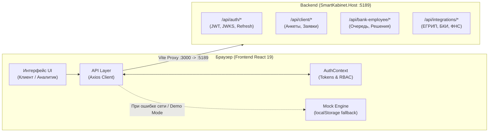
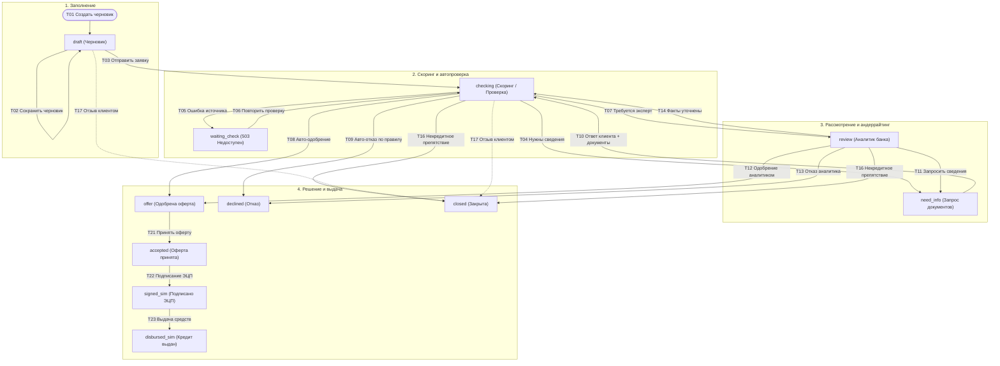

# FRONTEND.md
Руководство и архитектурный контекст для AI-ассистентов, работающих в репозитории Alfa-Hack 2026 («Умный кредитный кабинет предпринимателя»).

---

## 1. Обзор проекта и концепция

Фронтенд-приложение представляет собой современный веб-интерфейс кредитного кабинета предпринимателя (ИП) и рабочего места аналитика/андеррайтера Альфа-Банка:
* **Клиент (ИП)**: пошаговый мастер оформления кредита (визард с автоподтягиванием карточки ИП из ЕГРИП по ИНН), трекер жизненного цикла заявки (State Machine Stepper), ответы на дозапросы документов (`need_info`), работа со сценарием недоступности внешних сервисов (`waiting_check` 503), просмотр и принятие персональной оферты (`offer`) со встречным предложением (+6 месяцев) и симуляцией подписания договора ЭЦП.
* **Сотрудник банка (Аналитик / Андеррайтер)**: единое рабочее место андеррайтера — мониторинг очереди заявок (`review`), сверка заявленных данных с внешними реестрами (ЕГРИП, БКИ, ФНС), анализ скоринговых метрик (DSCR, скоринговый балл 0–100, стоп-факторы), панель принятия решений (одобрение T12, дозапрос сведений T11, отправка на перепроверку T14, отказ T13, закрытие по некредитному препятствию T16).
* **Жюри и Демо**: моментальный тумблер переключения ролей (`Client` ⇄ `BankEmployee`), переключатель светлой/тёмной темы, а также **автономный персистентный Mock Engine** (приложение полностью функционирует в браузере даже без запущенного бэкенда).

* **Платформа**: React 19 / TypeScript 5.7 / Vite 6
* **Стилизация**: Tailwind CSS 3.4 (с фирменной палитрой Alfa Red `#EF3124` и полной поддержкой Dark Mode)
* **Маршрутизация**: React Router 7 (`react-router-dom`)
* **Иконки и UI**: Lucide React, кастомная библиотека компонентов Альфа-Банка
* **HTTP клиент**: Axios с интерцепторами токенов, автоматической ротацией JWT и поддержкой HttpOnly Cookie

---

## 2. Архитектура решения и структура директорий

```text
frontend/
├── index.html                 # HTML-хост приложения, мета-теги, шрифты Inter
├── package.json               # Зависимости (React 19, Vite, Tailwind, Axios, Lucide)
├── vite.config.ts             # Конфигурация Vite, alias '@', проксирование /api на порт 5189
├── tailwind.config.js         # Палитра Альфа-Банка (alfa-500, alfa-dark), dark mode 'class'
├── tsconfig.json              # Базовая конфигурация TypeScript
├── tsconfig.app.json          # Настройки сборки клиентского кода
├── public/                    # Статические ассеты, favicon, логотипы
└── src/
    ├── main.tsx               # Точка входа React (React.StrictMode, ThemeProvider, AuthProvider)
    ├── App.tsx                # Корневой компонент с рендером AppRouter
    ├── index.css              # Базовые стили Tailwind, утилиты, кастомные скроллбары
    ├── api/                   # HTTP-клиенты, адаптеры и автономный Mock Engine
    │   ├── apiClient.ts       # Axios instance, перехватчик Bearer JWT, авто-рефреш при 401
    │   ├── authApi.ts         # Аутентификация (login, register, employeeLogin, refresh)
    │   ├── clientApi.ts       # API заявок ИП (CRUD, T03 submit, T06 retry, T10 info, T21 accept)
    │   ├── analystApi.ts      # API андеррайтера (очередь review, решения T11–T16, сверка реестров)
    │   ├── egripApi.ts        # Интеграция с симулятором ЕГРИП (поиск карточки ИП по ИНН)
    │   ├── mockStore.ts       # Локальный движок состояния и скоринга на базе localStorage
    │   ├── mockData.ts        # Тестовые данные: заявки, пользователи, скоринговые профили
    │   └── userStore.ts       # Синхронизация профилей пользователей
    ├── context/               # Глобальные контексты приложения
    │   ├── AuthContext.tsx    # Сессия, токены, авторизация, RBAC, тумблер смены роли
    │   └── ThemeContext.tsx   # Управление тёмной/светлой темой с сохранением в localStorage
    ├── router/                # Маршрутизация и гарды
    │   ├── AppRouter.tsx      # Конфигурация маршрутов (публичные, защищённые, 404)
    │   └── ProtectedRoute.tsx # HOC проверки роли пользователя (Client / BankEmployee)
    ├── types/                 # Строгая типизация доменной модели
    │   ├── application.ts     # Сущность заявки, статусы, коды переходов T01–T23, аудит
    │   ├── products.ts        # Кредитные продукты (WC, EQ, START), правила валидации
    │   ├── scoring.ts         # Результаты скоринга, расчет DSCR, стоп-факторы, риски
    │   ├── auth.ts            # Модели аутентификации, пользователи, роли, токены
    │   └── api.ts             # Обобщенные структуры ответов API, Result<T>
    ├── config/                # Конфигурационные файлы
    │   └── products.ts        # Справочник условий кредитных продуктов (суммы, сроки, ставки)
    ├── data/                  # Статические справочники и синтетические данные
    │   ├── suppliersData.ts   # Аккредитованные поставщики оборудования для продукта EQ
    │   └── bankSyntheticData.ts # Синтетические профили реестров ФНС/БКИ для демо
    ├── utils/                 # Утилиты форматирования и хелперы
    │   ├── formatters.ts      # Форматирование валюты (₽), дат, процентов, ИНН/ОГРНИП
    │   └── statusHelpers.ts   # Маппинг статусов State Machine на цвета, бейджи и тексты
    ├── components/            # Иерархия UI-компонентов
    │   ├── common/            # Атомарные элементы дизайн-системы (Button, Card, Input, Modal...)
    │   ├── layout/            # Каркас: Navbar (тумблер ролей, тема), AppLayout, Footer
    │   ├── badges/            # Индикаторы: ApplicationStatusBadge, ProductCodeBadge, RiskBadge
    │   ├── products/          # Карточки кредитных продуктов (CreditProductCard)
    │   ├── application/       # Доменные виджеты (Stepper, OfferCard, EgripCard, ScoringCard...)
    │   └── analyst/           # Панель решений андеррайтера (AnalystActionPanel)
    └── pages/                 # Экранные формы (Views)
        ├── auth/              # Вход клиента, регистрация ИП по ИНН, вход сотрудника
        ├── client/            # Дашборд ИП, мастер подачи заявки, карточка заявки
        ├── analyst/           # Очередь заявок андеррайтера, экран комплексного досье
        └── dev/               # Интерактивная карта переходов State Machine T01–T23
```

---

## 3. Организация компонентов и слоев (Component Architecture)

Архитектура фронтенда построена по принципу **модульного разделения ответственности (Feature & Layer-Based)**:

### 3.1. Общесистемные компоненты (`components/common/`)
* **`Button`**: фирменные стили кнопок Альфа-Банка (primary `alfa-500`, secondary, outline, danger, ghost), поддержка состояний `isLoading`, иконок и отключения.
* **`Card`**: адаптивные контейнеры с поддержкой тёмной темы (`dark:bg-slate-800`), заголовков, бейджей и разделителей.
* **`Input` / `Select` / `Textarea`**: унифицированные поля ввода с лейблами, подсказками, валидацией ошибок, масками и префиксами (₽, ИНН).
* **`Modal`**: доступный модальный оверлей с плавной анимацией, закрытием по `Esc` и клику на подложку, блокировкой скролла body.
* **`FileUpload`**: зона Drag-and-Drop загрузки файлов (PDF, PNG, JPG, XLS) с валидацией размера/типа и списком загруженных документов.
* **`Alert`**: блоки информационных, предупреждающих и критических сообщений (info, success, warning, danger).
* **`ErrorBoundary`**: перехватчик неотловленных ошибок React-дерева с выводом дружелюбного UI и кнопкой перезагрузки.

### 3.2. Доменные виджеты заявки (`components/application/`)
* **`StateMachineStepper`**: 4-этапный индикатор прогресса (1. Заполнение анкеты → 2. Скоринг и проверки → 3. Рассмотрение / Андеррайтинг → 4. Решение). Динамически подсвечивает текущий статус, ошибки 503 и переходы в `need_info`.
* **`OfferCard`**: интерактивная карточка одобренных условий:
  * Отображение одобренной суммы, ставки, ежемесячного платежа и срока.
  * **Умное встречное предложение (+6 месяцев)** с наглядным расчетом снижения финансовой нагрузки.
  * Кнопки принятия оферты (`T21`), перехода к ЭЦП (`T22`) и симуляции выдачи кредита (`T23`).
* **`ScoringCard`**: визуализация скоринговых метрик для аналитика и клиента: балл (0–100), расчетный DSCR, индикаторы стоп-факторов (просрочки, налоги ФНС).
* **`EgripCard`**: карточка юридического лица/ИП, сформированная на основе ответа сервиса ЕГРИП (наименование, ОГРНИП, дата регистрации, основной ОКВЭД).
* **`NeedInfoResponseModal`**: интерфейс ответа предпринимателя на запрос банка (`T10`) с вводом пояснений и прикреплением затребованных документов.
* **`TransitionHistoryModal`**: модальное окно полного журнала аудита заявки: хронологический список всех переходов с указанием времени, инициатора (`client`, `system`, `analyst`) и кода причины.
* **`ConsentModal`**: юридически значимое модальное окно согласий на запрос в БКИ и обработку персональных данных перед финальной отправкой заявки (`T03`).

### 3.3. Панель решений андеррайтера (`components/analyst/AnalystActionPanel`)
Инструментарий сотрудника банка для выполнения переходов из статуса `review`:
* **Одобрить оферту (`T12`)**: калькулятор условий (корректировка суммы, срока от 3 до 48 мес., ставки) с валидацией по лимитам продукта.
* **Запросить сведения (`T11`)**: формулирование запроса заёмщику с выбором типа требуемых документов (переход в `need_info`).
* **Уточнены факты (`T14`)**: отправка скорректированной анкеты на повторную автопроверку (переход в `checking`).
* **Отказать по заявке (`T13`)**: отказ с фиксацией структурированного кода причины и понятного для клиента обоснования.
* **Закрыть заявку (`T16`)**: фиксация некредитного препятствия.

---

## 4. Архитектурные границы и интеграция с Backend

### 4.1. Схема интеграции и гибридный транспорт



1. **Vite Reverse Proxy**:
   * В режиме разработки запросы к `/api/*` прозрачно проксируются на бэкенд `http://localhost:5189` (или `http://localhost:5000` в зависимости от конфигурации `VITE_API_BASE_URL`).

2. **Dual-Token Pattern & Axios Interceptors**:
   * При наличии токена в `localStorage` перехватчик запросов добавляет заголовок `Authorization: Bearer <accessToken>`.
   * Конфигурация `withCredentials: true` гарантирует параллельную передачу защищенных cookie (`auth-cookies`, `refresh-token`).
   * При получении статуса `401 Unauthorized` перехватчик ответов выполняет единичную попытку обновления пары токенов через эндпоинт `POST /api/auth/refresh` и повторяет оригинальный запрос без принудительного разлогина.

3. **Нормализация контрактов (Contract Mapping)**:
   * Модули `mapBackendApplication` и `mapBackendScoring` преобразуют числовые и строковые структуры бекенда в строго типизированные интерфейсы TypeScript, изолируя UI от расхождений в именовании полей (`id` vs `applicationId`, перечисления стадий бизнеса).

4. **Автономный Mock Engine (`mockStore.ts`)**:
   * Полнофункциональная эмуляция скорингового движка и конечного автомата T01–T23 прямо в браузере.
   * При недоступности бэкенда или активации демо-режима заявки, переходы, скоринг и аудит сохраняются в `localStorage`. Это обеспечивает 100% готовность интерфейса к демонстрации на хакатоне в любых сетевых условиях.

---

## 5. Аутентификация, безопасность и ролевая модель (RBAC)

### 5.1. Ролевая модель
Приложение разграничивает доступ на основе ролей:
* **`Client`**: доступ к маршрутам заёмщика (`/client/dashboard`, `/client/new`, `/client/applications/:id`).
* **`BankEmployee`**: доступ к рабочему месту андеррайтера (`/analyst/queue`, `/analyst/review/:id`).

### 5.2. Управление сессией (`AuthContext.tsx`)
* **Автоматическое восстановление сессии**: чтение пользователя и токенов из `localStorage` при инициализации.
* **Тумблер смены роли (`switchRole`)**: расположен в верхней панели навигации (`Navbar.tsx`). Позволяет мгновенно переключить текущую активную роль между Клиентом и Сотрудником банка без повторного ввода паролей — критически важно для презентации жюри.
* **Вход сотрудника**: отдельный экран `/employee/login` с быстрыми демо-аккаунтами аналитиков банка.
* **Регистрация клиента**: пошаговый поиск реквизитов ИП по ИНН через сервис ЕГРИП с автозаполнением ФИО, ОГРНИП и ОКВЭД.

### 5.3. Ключи локального хранилища
* `smart_kabinet_access_token` — JWT токен доступа
* `smart_kabinet_refresh_token` — токен обновления сессии
* `smart_kabinet_user` — сериализованный профиль текущего пользователя
* `smart_kabinet_demo_mode` — флаг автономного демонстрационного режима
* `smart_kabinet_theme` — выбранная цветовая тема (`light` | `dark`)
* `smart_kabinet_mock_applications` — персистентное хранилище заявок Mock Engine

---

## 6. Жизненный цикл заявки (State Machine Stepper & T01–T23)

### 6.1. Диаграмма переходов состояний на фронтенде



### 6.2. Обработка краевых сценариев и UX-паттерны

1. **Сценарий 503 (`waiting_check`, T05/T06)**:
   * Если внешний реестр (ФНС/БКИ) недоступен, заявка не бракуется.
   * На экране заявки выводится специальный янтарный информационный баннер с понятным объяснением и кнопкой **«Повторить проверку» (`T06`)**.

2. **Сценарий дозапроса сведений (`need_info`, T04/T11/T15/T10)**:
   * Отображается текст запроса от банка/системы и список запрашиваемых документов.
   * Клиент отвечает через модальное окно `NeedInfoResponseModal` с возможностью загрузки файлов и отправки заявки обратно на скоринг (`T10`).

3. **Сценарий встречного предложения (+6 месяцев) и выдачи (`offer` → `disbursed_sim`)**:
   * Для клиентов с повышенной кредитной нагрузкой система рассчитывает альтернативный график со сроком +6 месяцев, снижающий ежемесячный платеж.
   * Предусмотрен полный цикл завершения сделки: принятие оферты (`T21`) → ввод SMS-кода для симуляции ЭЦП (`T22`) → моментальное зачисление средств на расчетный счет заёмщика (`T23`).

4. **Прозрачный аудит и история переходов (`TransitionHistoryModal`)**:
   * Любой переход фиксирует запись: `previousStatus`, `newStatus`, `actor` (`client`, `system`, `analyst`), `reasonCode`, `timestamp`.
   * Клиент и аналитик могут открыть полный таймлайн истории изменений в один клик.

---

## 7. Кредитные продукты и правила валидации

Конфигурация продуктов централизована в `src/config/products.ts`:

| Код | Название | Стадия бизнеса | Цель | Сумма (₽) | Срок (мес) | Взнос | Кто решает |
| :--- | :--- | :--- | :--- | :--- | :--- | :--- | :--- |
| **`WC`** | Оборотный кредит | `operating` (действующий) | `working_capital` | 100 тыс. – 3 млн | 3 – 24 | 0% | Система (автоматически) |
| **`EQ`** | Кредит на оборудование | `operating` / `prelaunch` | `equipment` | 300 тыс. – 5 млн | 6 – 48 | от 10% (действующий) / от 20% (новый) | Гибридно (система / аналитик) |
| **`START`** | Старт бизнеса (оборотные) | `prelaunch` (новый) | `working_capital` | 100 тыс. – 1 млн | 3 – 18 | от 20% | Аналитик банка (вручную) |

* **Инлайн-валидация параметров**: при вводе суммы или срока за пределами лимитов продукта мастер мгновенно выводит предупреждение и подсказывает альтернативный подходящий продукт.
* **Калькулятор взноса**: для оборудования (`EQ`) сумма кредита автоматически рассчитывается как разница стоимости оборудования и собственного взноса заёмщика.

---

## 8. Дизайн-система и UI/UX паттерны

1. **Брендинг Альфа-Банка**:
   * Основной акцентный цвет: Alfa Red `#EF3124` (`alfa-500`), тёмно-красный при наведении `#DC2626` (`alfa-600`).
   * Тёмный фон интерфейса: `#1E2022` (`alfa-dark`).
   * Высококонтрастная типографика на базе системного шрифта `Inter`.

2. **Поддержка Dark Mode (`ThemeContext.tsx`)**:
   * Переключение темы через класс `dark` на корневом теге `<html>`.
   * Автоматическое определение системной темы пользователя (`prefers-color-scheme: dark`).
   * Сохранение выбранной темы в `localStorage` (`smart_kabinet_theme`).

3. **Адаптивность и доступность (A11y)**:
   * Полная поддержка мобильных экранов, планшетов и десктопов (сетки Tailwind CSS).
   * Семантические теги HTML5 (`nav`, `main`, `section`, `header`, `button`).
   * Фокусные состояния (`focus:ring-2 focus:ring-alfa-500`) для удобной навигации с клавиатуры.
   * Контрастные текстовые бейджи статусов с дублированием цветовой индикации текстовым пояснением.

---

## 9. Экосистема навыков (Skills Ecosystem) & Политика активации

При разработке и сопровождении фронтенда AI-ассистенты должны руководствоваться следующими навыками:

### 9.1. Постоянно активные навыки (Always-On)
1. **`caveman`** ([`.agents/skills/caveman/SKILL.md`](.agents/skills/caveman/SKILL.md)):
   * Ультралаконичный стиль коммуникации в чате, фокус на конкретных технических изменениях без лишнего многословия.
2. **`karpathy-guidelines`** ([`.agents/skills/karpathy-guidelines/SKILL.md`](.agents/skills/karpathy-guidelines/SKILL.md)):
   * Четыре базовых принципа:
     1. *Think Before Coding* — анализ существующих интерфейсов и типов перед изменением.
     2. *Simplicity First* — использование стандартных хуков и компонентов React без лишних абстракций.
     3. *Surgical Changes* — точечные правки без разрушения соседних компонентов.
     4. *Goal-Driven Execution* — проверка успешной сборки проекта через `npm run build`.

### 9.2. Навыки по требованию (On-Demand)
1. **`modern-web-guidance`**:
   * **Триггер**: верстка новых экранов, модальных окон, анимации переходов, доступность форм, работа со скроллом и темами оформления.
2. **`a11y-debugging`**:
   * **Триггер**: проверка доступности элементов интерфейса (ARIA-атрибуты, цветовой контраст, клавиатурный фокус).
3. **`chrome-devtools`**:
   * **Триггер**: диагностика сетевых запросов Axios, инспекция DOM, отладка производительности рендеринга.

---

## 10. Команды сборки и разработки

Все команды выполняются из каталога `frontend/`:

```bash
# Переход в директорию фронтенда
cd frontend

# Установка зависимостей
npm install

# Запуск локального сервера разработки (порт 3000)
npm run dev

# Проверка типов TypeScript и production-сборка
npm run build

# Локальный предпросмотр собранного production-бандла
npm run preview
```

### Переменные окружения (`.env`):
* `VITE_API_BASE_URL` — базовый URL бэкенда (по умолчанию `/api`, проксируется Vite на `http://localhost:5189`).
