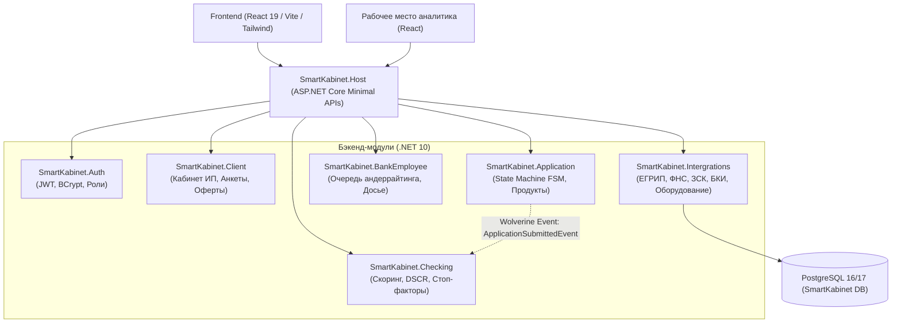

# SmartKabinet — Умный кредитный кабинет предпринимателя (ИП)
> **Решение кейс-чемпионата «Альфа-Будущее Хакатон 2026»**  
> **Трек:** Умный кредитный кабинет предпринимателя

---

## 1. О проекте
**SmartKabinet** — автономный веб-сервис для экспресс-кредитования индивидуальных предпринимателей. Сервис объединяет клиентский путь подачи заявки и автоматизированное рабочее место риск-аналитика банка со сквозной обработкой заявки: от ввода ИНН до моделируемой выдачи кредитных средств.

### Ключевые возможности:
- **Автозаполнение по ИНН**: интеграция с синтетическими реестрами ЕГРИП, ФНС («Прозрачный бизнес»), платформой ЗСК ЦБ РФ и реестром банкротств ЕФРСБ.
- **Два независимых признака кредитования (4 сценария)**:
  - `stage`: `operating` (действующий бизнес) или `prelaunch` (на этапе запуска).
  - `purpose`: `working_capital` (пополнение оборотных средств) или `equipment` (покупка оборудования).
- **Линейка кредитных продуктов**:
  - `WC` (Оборотный кредит): 100 000 – 3 000 000 ₽, 3–24 мес.
  - `EQ` (Кредит на оборудование): 300 000 – 5 000 000 ₽, 6–48 мес (взнос от 10% для operating, от 20% для prelaunch).
  - `START` (Старт для нового бизнеса): 100 000 – 500 000 ₽, 6–18 мес.
- **Прозрачный движок скоринга и кредитных решений**:
  - Расчёт аннуитета: $P = S \cdot \frac{r}{1 - (1+r)^{-n}}$.
  - Базовые ставки: 18% (при баллах 85+), 21% (при 70–84).
  - Встречное предложение (при баллах 50–69): увеличение срока шагом +6 мес под 24% до достижения $DSCR \ge 1.5$.
  - Стоп-факторы: задолженность ФНС > 50 000 ₽ (`TAX_DEBT`), просрочка > 30 дней (`OVERDUE_GT_30`), блокировки счетов, банкротство.
- **Строгий конечный автомат (State Machine T01–T28)** с аудитом каждого перехода (`TransitionHistory`).
- **Моделируемая выдача**: принятие оферты $\rightarrow$ подписание договора ЭЦП $\rightarrow$ зачисление на расчётный счёт.

---

## 2. Архитектура решения

Решение построено по принципам модульного монолита (Modular Monolith):



---

## 3. Учётные записи для проверки

В системе предварительно созданы тестовые пользователи:

| Роль | Логин | Пароль | Тестовый субъект (ИНН) | Описание сценария |
|---|---|---|---|---|
| **Клиент ИП** | `client1` | `Password123!` | `500100000011` | **S1:** Иванов, торговля 5 лет. WC 800к. Авто-одобрение (балл 100, 18%). |
| **Клиент ИП** | `client2` | `Password123!` | `500100000022` | **S2:** Сидорова, 3 года. EQ 2.5м. Запрос сведений $\rightarrow$ встречное оферта на 30 мес под 24%. |
| **Клиент ИП** | `client3` | `Password123!` | `500100000033` | **S3:** Кузнецов. WC 500к. Просрочка 45 дн $\rightarrow$ авто-отказ (`OVERDUE_GT_30`). |
| **Клиент ИП** | `client4` | `Password123!` | `500100000044` | **S4/S5:** Новикова (prelaunch, 2 недели). EQ 2м $\rightarrow$ ручной разбор аналитика. |
| **Клиент ИП** | `client5` | `Password123!` | `500100000077` | Чужой ИП $\rightarrow$ проверка изоляции доступа. |
| **Аналитик** | `analyst` | `Password123!` | — | Вход в рабочее место сотрудника банка (`/analyst/queue`). |

*(Также доступна свободная регистрация нового ИП или сотрудника банка).*

---

## 4. Сквозные тестовые сценарии (S1–S5)

### Сценарий S1: Проверка скоринга и одобрение сотрудником (Operating + WC)
1. Войдите как `client1` (`Password123!`).
2. В анкете введите ИНН `500100000011` $\rightarrow$ данные подтянутся из ЕГРИП («ИП Иванов Иван Иванович»).
3. Выберите: действующий бизнес (`operating`), оборотные средства (`working_capital`), сумма `800 000 ₽`, срок `12 мес`.
4. Отправьте заявку $\rightarrow$ скоринг рассчитывает $DSCR = 3.9$, балл 100 и рекомендуемые параметры, передавая результат аналитику (статус `review`, T07). Скоринг сам ничего клиенту не отправляет.
5. Войдите как `analyst` (`Password123!`) $\rightarrow$ в очереди `/analyst/queue` откройте досье, ознакомьтесь со скорингом и нажмите **«Одобрить оферту (T12)»** (параметры оферты подставляются из расчёта скоринга). Заявка переходит в статус `offer`.
6. Клиент видит предложение в личном кабинете и нажимает **«Принять предложение и получить деньги»**: заявка проходит цепочку `accepted` $\rightarrow$ `signed_sim` $\rightarrow$ `disbursed_sim`. Деньги смоделированно зачислены.

### Сценарий S2: Встречное предложение (Operating + EQ)
1. Войдите как `client2` (ИНН `500100000022`).
2. Покупка оборудования: стоимость `2 500 000 ₽`, собственный взнос `250 000 ₽`, срок `24 мес`.
3. Запрошенных параметров недостаточно для $DSCR \ge 1.5$ $\rightarrow$ система предлагает встречные условия: срок увеличен до `30 мес`, ставка `24%`.

### Сценарий S3: Автоматический отказ по стоп-фактору
1. Войдите как `client3` (ИНН `500100000033`).
2. При скоринге срабатывает стоп-фактор БКИ: критическая просрочка 45 дней.
3. Заявка моментально отклоняется со статусом `declined` и понятной клиенту причиной: *«В кредитной истории есть просрочка более 30 дней. Подать заявку снова можно после её погашения»*.

### Сценарий S4: Ручной андеррайтинг нового бизнеса (Prelaunch + EQ)
1. Войдите как `client4` (ИНН `500100000044`, бизнес открыт 2 недели назад).
2. Заявка на оборудование для кофейни: стоимость `2 000 000 ₽`, взнос `400 000 ₽` (20%).
3. Заявка уходит в статус `review` (передана аналитику банка).
4. Войдите под ролью `analyst` (`Password123!`) $\rightarrow$ откройте `/analyst/queue`.
5. Аналитик видит полное досье, скоринг, финансовые параметры и принимает решение (Одобрить T12 / Отказать T13 / Запросить сведения T11).

### Сценарий S5: Превышение лимита продукта
1. Для нового бизнеса (`prelaunch`) запросите оборотный кредит на `2 000 000 ₽`.
2. Система вернёт код `PRODUCT_NA_AMOUNT`: максимальная сумма для нового бизнеса по продукту START — 500 000 ₽. Клиенту предлагается скорректировать сумму без кредитного отказа.

---

## 5. Быстрый запуск

### Требования к окружению:
- .NET SDK 10.0 (или .NET 9.0)
- Node.js 20+ и npm
- PostgreSQL 15+

### Шаг 1. База данных PostgreSQL
Создайте БД `SmartKabinet` и примените синтетические данные:
```bash
psql -U postgres -d SmartKabinet -f backend/scripts/create_synthetic_tables.sql
psql -U postgres -d SmartKabinet -f backend/scripts/seed_synthetic_data.sql
```

### Шаг 2. Запуск Backend
В файле `backend/SmartKabinet.Host/appsettings.json` проверьте строку подключения `DefaultConnection`.
Запустите бэкенд:
```bash
cd backend
dotnet run --project SmartKabinet.Host/SmartKabinet.Host.csproj
```
Сервис доступен по адресу: `http://localhost:5189`.  
Swagger UI: `http://localhost:5189/swagger`.

### Шаг 3. Запуск Frontend
```bash
cd frontend
npm install
npm run dev
```
Интерфейс откроется по адресу: `http://localhost:5173`.

---

## 6. Спецификация API
- **Интерактивный Swagger**: `http://localhost:5189/swagger`
- **Экспорт OpenAPI JSON**: сохранён в репозитории по пути [`docs/openapi.json`](docs/openapi.json) (готов для импорта в Postman или Insomnia).
- **Сведения об открытых лицензиях**: [`THIRD_PARTY_NOTICES.md`](THIRD_PARTY_NOTICES.md).
